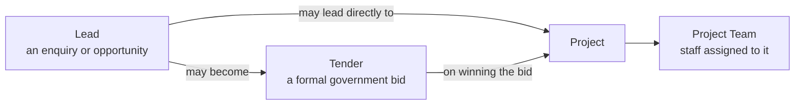
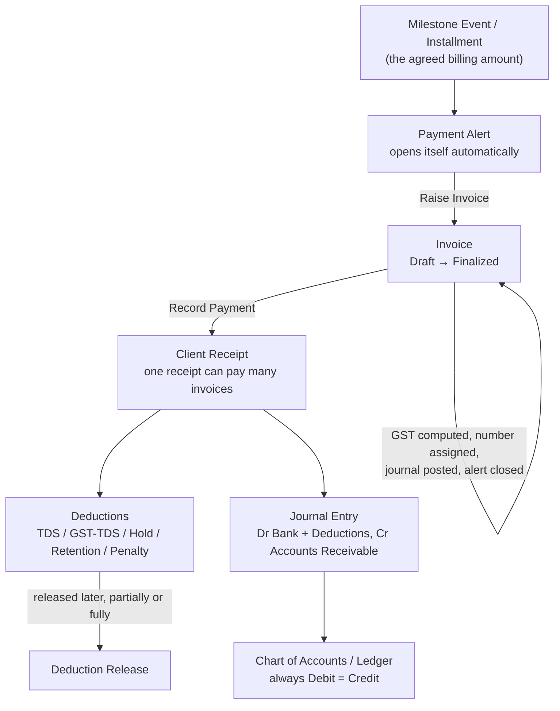

# MT Gov CRM — Founder Summary

*A plain-language walkthrough of what has been built, how it works, and what's still ahead — organized the same way the build itself is organized: in phases.*

Last updated: 2026-08-19

## How to read this document

This system is being built one **phase** at a time, on purpose — each phase is a complete, working slice of the business, not a half-built screen. A phase isn't started until the one before it is solid, tested, and (for anything financial) mathematically correct down to the rupee.

For each phase below you'll find:

- **What it means for your business**, in plain terms — not developer language.
- **What you can now do** that used to live in Excel, Tally, or someone's memory.
- **How it flows**, as a simple diagram.
- **A worked example** with real numbers, where it helps.
- **Status** — done, in progress, or not started yet.

A separate, more technical companion document (field-by-field data structure, every screen, every edge case) will follow this one. This document is the map; that one will be the atlas.

---

## The roadmap at a glance

| Phase | Covers | Status |
|---|---|---|
| 0 | Design pack — locking every screen and rule before writing code | ✅ Complete |
| 1 | The technical skeleton — website, brain, and background worker | ✅ Complete |
| 2 | Company setup — organization, legal entities, GST, financial years, users, roles | ✅ Complete |
| 3 | Clients, Leads, Tenders, Projects, project teams | ✅ Complete |
| 4 | Milestones, Payment Alerts, Chart of Accounts, the posting engine, EMD/SD | ✅ Complete |
| 5 | Invoicing and receiving payment, with deductions | 🟡 Verified and working — only Bank Reconciliation left to build |
| 6 | Vendors, purchase requests, bills, payments, expenses | ⬜ Not started |
| 7 | Inventory, salary import, project costing, introducer commissions | ⬜ Not started |
| 8 | P&L, aging, GST/TDS registers, reconciliation reports | ⬜ Not started |
| 9 | Load testing, backups, security review, data migration, go-live | ⬜ Not started |

---

## Phase 0 — Design Pack ✅

Before a single line of code was written, every one of the 103 screens your team had already designed was reviewed, and every business rule behind them (how GST splits, how milestones bill, how a project moves through its stages) was confirmed against your actual practice — not assumed. Anything ambiguous was written down as a decision, not guessed at.

**Why this mattered:** it means the screens you'll eventually see were never redesigned from scratch — they follow the layouts, fields, and language your team already validated.

---

## Phase 1 — Engineering Foundation ✅

Think of this as pouring the foundation slab before building the house — nothing business-facing yet, but everything after it stands on this.

The system is split into three parts that always run together:

- **The website** — what your team actually sees and clicks.
- **The brain (API)** — where every calculation, rule, and permission check happens. The website never calculates money on its own; it always asks the brain.
- **The background worker** — does automatic jobs on its own schedule (like checking every 15 minutes whether a payment alert should open), even when nobody is logged in.

All three run with one command (`npm run dev`) on a development machine, and are managed by a standard process manager (PM2) in production — no Docker, no extra infrastructure to babysit.

---

## Phase 2 — Company Setup & Access Control ✅

This is where your company itself gets set up *inside* the system.

**What's in place:**

- **Legal entities and GST registrations** — if you operate through more than one registered entity or GSTIN, each is tracked separately, with its own invoices, ledgers, and financial years.
- **Financial years and accounting periods** — each month is a period that moves through a controlled lifecycle:

  A locked month cannot silently be reopened by the same person who closed it — someone else has to do it, with a reason recorded. This is the same "maker-checker" discipline auditors expect, built into the software rather than relying on trust.

- **Users, roles, and permissions** — Admin, Accountant, Project Manager, CEO, Admin Staff, etc. Every action anywhere in the system — from viewing a list to posting a journal — is gated by a specific permission, not a blanket "logged in" check.
- **Employee master** — kept separate from login accounts, because not every employee needs system access, and not every system user is an employee (e.g. an external accountant).
- **Common dropdown lists (masters)** — departments, designations, lead types/sources, project types, EMD/SD purposes and types, penalty categories, payment modes — all editable from one consistent screen family instead of being hardcoded.
- **Document storage** — any record (a lead, a tender, a project) can have files attached to it, stored securely.
- **Audit trail** — every meaningful action is logged with who, what, and when. This log itself can never be edited or deleted, by anyone, including an Admin.
- **Automatic notifications** — the background worker can email/notify the right people (e.g. "everyone who can snooze a payment alert") without a person triggering it manually.

---

## Phase 3 — Clients, Leads, Tenders, and Projects ✅

This is your CRM and project-tracking layer — the funnel from "someone might want to work with us" to "we're delivering a government project."

**What's in place:**

- **Clients** (government bodies/departments you work with) with contacts and profile details, including GST info used later for invoicing.
- **Leads** — an enquiry, with its own update/activity log and file attachments. Every lead can be traced back to how it originated (referral, introducer, direct, etc.).
- **Tenders** — a formal government tender your company is bidding on, tracked independently of whether it came from a lead. A tender has two separate dials: *submission status* (has it even been submitted) and *result* (won/lost/pending) — kept apart deliberately, since they answer different questions.
- **Projects** — the real, contracted work. A project can trace back to a Lead, a Tender, both, or be created directly. Every project has a **Stage** (where it is in its lifecycle) and, separately, an **Operational Status** (healthy/delayed/on-hold) — again two independent dials, because a project's phase and its health aren't the same question.
- **Project team assignments and scoping** — a Project Manager only sees and acts on *their own* assigned projects by default, not the whole company's project list, unless explicitly given wider access. This is enforced everywhere, not just on one screen.
- **Physical progress log and project documents** — an append-only timeline of progress (percentage complete only ever goes up, never gets silently walked back) plus attached files, both scoped so a Project Manager can't reach another PM's project data.

---

## Phase 4 — The Accounting Engine, Milestones, and EMD/SD ✅

This phase is the financial heart of the system — everything from here onward that touches money runs through the same, single, tested engine. This matters because it means there is exactly **one place** in the entire system where a journal entry can be created, and it is mathematically impossible to save one that doesn't balance.

### Milestones — how a project gets billed

Every project's billing is defined upfront as either **CAPEX** (deliverable-based) or **OPEX** (recurring), never a mix on the same milestone.

- **CAPEX milestone** — a fixed pool of money split into named, dated events. Example: a ₹50,00,000 milestone split into "On Design Approval — 20% (₹10,00,000)" and "On Completion — 80% (₹40,00,000)." The system enforces that the event amounts always add up to exactly the pool amount — not a rupee more or less.
- **OPEX milestone** — a recurring schedule. Example: a ₹12,00,000 annual O&M contract becomes 12 monthly installments of ₹1,00,000 each, generated automatically with correct calendar-safe dates (so month-end doesn't quietly shift).

### Payment Alerts — nothing gets forgotten

The background worker checks every 15 minutes whether a CAPEX event or OPEX installment has become due (or was marked achieved), and **automatically opens an alert** — no one has to remember to check a spreadsheet. An alert can be *snoozed* (with a note) and will reopen itself once the snooze period passes.

### Chart of Accounts and the Posting Engine

Your ledger structure (Assets, Liabilities, Equity, Income, Expenses, and everything under them) lives here, and every financial event elsewhere in the system — an invoice, a receipt, a security deposit — automatically creates a proper double-entry journal against it. No screen anywhere in the system lets a user, or even the website itself, compute or enter accounting totals directly; every number is calculated by the one shared engine and only *displayed* for confirmation.

### Corrections — reversal, not editing

Once a journal entry is posted, it is never edited or deleted, even by an Admin. A mistake is corrected by posting an equal-and-opposite **reversal** that references the original — so the full history is always intact, exactly as an auditor would expect.

### EMD/SD — security deposits and earnest money

- A **cash-type** instrument (cash, DD, FDR, banker's cheque, online payment) automatically posts a "recoverable" entry when lodged, and its mirror entry when returned.
- A **guarantee-type** instrument (bank guarantee, insurance surety bond) posts nothing — it's tracked only as an off-balance-sheet exposure, since no actual money leaves your account.

**Example:** ₹5,00,000 EMD paid by NEFT for a tender → the system posts *Dr Recoverable (EMD) / Cr Bank ₹5,00,000* the moment it's lodged. Months later when the department returns it in full, the system posts the mirror entry and flips the record from "Lodged" to "Returned." If it had been a Bank Guarantee instead, no cash entry is posted at all — only the exposure is tracked.

---

## Phase 5 — Billing & Collections 🟡 *(verified and working — only Bank Reconciliation left to build)*

This is the day-to-day cycle your finance team will live in: turning a milestone into an invoice, and an invoice into cash in the bank.

### Invoices

An invoice can **only** be created from an open Payment Alert — there is no "create a blank invoice" button anywhere, because every invoice must trace back to a real, approved milestone or installment. Finalizing an invoice:

- Computes GST correctly on its own — **CGST + SGST** if buyer and seller are in the same state, **IGST** if different states, and never both at once.
- Freezes the seller and buyer details onto the invoice permanently, so if your company's registered address changes next year, invoices issued today don't silently change with it.
- Assigns the invoice number automatically (scoped per GST registration and financial year).
- Posts the accounting entry and closes the alert that raised it — all as one atomic step.

A draft invoice can still be edited or voided freely. A **finalized** invoice can only be voided with a written reason, which automatically reverses its journal entry and reopens the original alert so the milestone can be billed correctly again.

### Client Receipts

- One bank receipt can be split across **multiple invoices**, and one invoice can be paid off by **multiple receipts** over time — matching how government payments actually arrive.
- Every deduction the client applies — TDS, GST-TDS, Hold, Retention, Accepted Penalty, Disputed Penalty, Other — is captured as its **own typed record** with its own ledger account, so you can always see exactly why the money received is less than the invoice amount, instead of one unexplained shortfall.
- Holds and retentions can be **released** later, partially or in full, whenever the department actually pays them out.
- The receipt screen never calculates totals on its own — every number shown is computed by the server and displayed for confirmation before it's posted, so what you see is exactly what gets recorded.

**Worked example:**

> Invoice: ₹10,00,000 taxable + 18% GST (same state, so 9% CGST + 9% SGST) = **₹11,80,000 total**.
>
> Client pays by bank transfer, but deducts as they remit:
> - TDS 10% on the base value = ₹1,00,000
> - Retention held per contract = ₹1,00,000
>
> **Cash actually credited to your bank: ₹9,80,000**
> **Settled against the invoice: ₹9,80,000 (cash) + ₹1,00,000 (TDS) + ₹1,00,000 (retention) = ₹11,80,000**
>
> The invoice shows as **fully settled (₹0 outstanding)**, even though only ₹9,80,000 hit the bank — the remaining ₹2,00,000 is tracked as a recoverable TDS credit and a held retention, each individually visible and each individually releasable later.

### Credit Notes and Debit Notes

Until now, the only way to correct an already-finalized invoice was to **Void** it — which cancels the whole thing and forces a full re-bill, even for a small rate or quantity mistake. A Credit Note (reduces what's owed) or Debit Note (increases it) now lets your team correct just the difference, referencing the original invoice, without touching it.

- A Credit Note can never exceed what was actually billed on that invoice — the system blocks it automatically. There's no equivalent cap on a Debit Note, since an additional charge is a fresh amount, not a refund of something already capped.
- Both get their own numbering series — `CN-0001`, `DN-0001` — kept separate from your invoice numbers, matching how GST correction documents are expected to be numbered.
- Issuing a note never reopens or changes the original invoice — it's a standalone correction on record, exactly the way an auditor would expect to see it.

**Example:** Invoice `0007` was finalized for ₹2,00,000 + GST, but the client later points out the quantity was overstated by ₹20,000. Instead of voiding the whole ₹2,36,000 invoice, your team issues a Credit Note for just the ₹20,000 correction (+ its GST). The invoice itself stays exactly as issued; the Credit Note is the record of the adjustment, and the amount still owed on the invoice drops by the credited amount automatically.

**What I personally worked on today:** the "which invoice am I paying" dropdown, used both from the global Payment screen and from inside a project, now shows the milestone name and the exact amount still outstanding on each invoice (showing ₹0 the moment an invoice is fully paid) — so your team doesn't have to open each invoice individually just to check before recording a payment.

### Ledger Opening Balances

Every ledger balance in the system used to start counting from zero on the day the system went live — there was no way to tell it "this bank account already had ₹5,00,000 in it before we started using this software." Your team can now set that starting figure, per account and per legal entity, as of whatever date makes sense (typically the day you began tracking that account here).

- Under the hood this isn't a special or separate number — it's recorded as a normal accounting entry, dated as of that starting day, exactly like every other entry in the system. That's deliberate: it means the ledger stays honest and self-balancing, and if a starting figure is ever entered wrong, correcting it works exactly like every other correction in this system — void it (with a reason, on record) and set the right one.
- Kept separate **per legal entity** — if you ever operate through more than one registered company, each one's opening figures stay strictly its own, never mixed into another entity's numbers even if they happen to share the same type of account (e.g. two companies both having their own "Bank" account).
- This was also the one piece blocking real **bank reconciliation** (matching your actual bank statement against what the system shows) from being buildable — it's the next item up.

### Still ahead in Phase 5

- **Bank transaction import & reconciliation** — matching your actual bank statement lines against receipts automatically. This was the one item still waiting on Opening Balances above; it's now unblocked.
- A richer **Ledger Viewer** (account view / journal view toggle, exportable, expandable entry detail) — also newly practical now that a ledger's starting point is real.

---

## Phase 6 — Vendors & Expenses ⬜ *(planned, not yet built)*

The mirror image of Phase 5, but for money going *out* instead of coming *in*: vendor master, purchase requests and approvals, an optional purchase order, goods/service receipt, vendor bills with explicit GST lines, payment requests and approvals, vendor payments with TDS, direct expenses, and employee advances/claims/reimbursements — plus subscription and server renewal reminders.

Two rules are already locked in for when this phase is built, because they were confirmed as non-negotiable for your business: **the person who raises an approval request can never be the same person who approves it**, and **approving a request never itself posts an expense** — the bill and the payment remain separate, always reconcilable steps, exactly like Invoice and Receipt are today.

---

## Phase 7 — Inventory & Costing ⬜ *(planned, not yet built)*

- Product/item master and central inventory receipt & consumption, linked back to purchases and vendor bills.
- Weighted-average stock valuation.
- Monthly salary import with a unified employee cost allocation — so a project's true cost includes people-cost, not just cash expenses.
- Introducer agreements, commission accrual, advances, payments, and allocations.

A submitted employee's monthly time/cost allocation across projects must always total exactly 100% — no partial or over-allocated months.

---

## Phase 8 — Reports & Controls ⬜ *(planned, not yet built)*

The reporting layer that ties everything above together: accrual and cash-basis Project P&L (kept clearly labeled as separate, since they tell different stories), contract/budget performance, receivable and payable aging, GST input/output/net registers, TDS reconciliation, cash flow and bank reconciliation, EMD/SD and introducer statements, and audit/exception dashboards.

Every single report will state which accounting basis it uses, and every report total must reconcile exactly back to the ledger control accounts — no report is allowed to show a number the ledger itself can't explain.

---

## Phase 9 — Hardening & Go-Live ⬜ *(planned, not yet built)*

The final phase before your team runs on this day-to-day: performance/load testing, backup-and-restore drills, a security review, production monitoring and alerts, tools to import your existing historical records into the new system, and a full walkthrough of every original screen with your finance users before sign-off.

---

## Where things stand right now

- **Phases 0 through 4 are fully complete** — the entire foundation, company setup, CRM/project layer, and accounting engine (milestones, alerts, chart of accounts, posting engine, period locks, reversals, EMD/SD) are built, tested, and verified in a live browser.
- **Phase 5 (Invoicing, Client Receipts, Credit/Debit Notes, and Ledger Opening Balances) is fully complete — both backend and screens, verified live.** The only piece of Phase 5 not yet built is Bank Transaction Reconciliation, now genuinely unblocked and ready to start whenever you want it.
- **Phase 6 onward has not been started** — by design, so that Phase 5 is airtight before the vendor/expense side of the business is built on top of the same proven engine.

The detailed technical companion document (data structure, every screen, every business rule, every scenario) will follow next.
